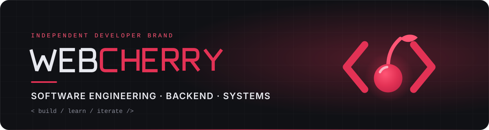
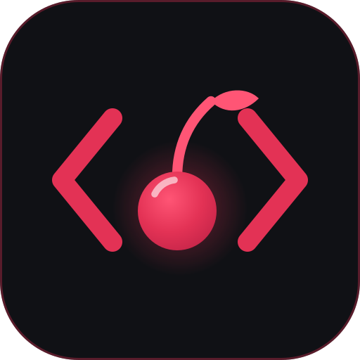

# Sebastian Wisniewski

### Software Engineering Student · Backend & Systems Focus

**Building reliable software. Exploring systems. Engineering with purpose.**

---

## `01 / PROFILE`

I'm a Software Engineering student currently completing an **HND in Software Development**, with plans to progress into the **BEng (Hons) Software Engineering programme at Edinburgh Napier University**.

My main interest is building reliable backend systems, structured application architectures and database-driven applications. My primary development stack is **C# and .NET**, complemented by experience with **Java, PHP, SQL and JavaScript**.

I enjoy understanding how software works beneath the interface: from object-oriented design and data structures to database design, application logic and performance.

I'm interested in **software engineering internships, junior development opportunities and collaborative open-source projects**.

## `02 / TECHNOLOGY`

**PRIMARY STACK**

**LANGUAGES & WEB**

**TOOLS & PLATFORMS**

**Engineering interests:** Object-Oriented Design · RESTful API Design · Relational Database Design · Data Structures & Algorithms · Unit Testing · Debugging · Separation of Concerns

**Currently exploring:** Microsoft Azure · Docker · CI/CD · Cloud Infrastructure · LLM / AI API Integration

## `03 / SELECTED WORK`

### [FinanceTracker by WebCherry](https://github.com/sebcherry6/PersonalFinanceTrackerWeb)

**C# · ASP.NET Core MVC & Web API · Entity Framework Core · SQLite · xUnit · Docker**

A personal finance web app for tracking spending, budgets and savings goals, built with security as a first-class feature.

- Relational data model with EF Core migrations; every query scoped to the signed-in user.
- ASP.NET Core Identity with account lockout, rate limiting, CSRF protection and a strict Content-Security-Policy.
- JSON REST API with bearer tokens that are revoked when the password changes.
- xUnit tests that prove the security controls hold, plus CI on GitHub Actions and a non-root Docker image.

### [The Lost Robot Story](https://github.com/sebcherry6/TheLostRobotStory)

**C# · MonoGame · Object-Oriented Design**

A 2D platformer about a factory robot that loses its connection to the system, goes rogue and fights its way out of a futuristic lab.

- Built the game loop, scene flow and level loading on top of MonoGame.
- Developed the player controller: movement, jumping and collision physics with animation states.
- Implemented enemy and hazard behaviour for the factory's security systems.
- Structured the code into reusable components (entities, input, rendering, levels) to keep new mechanics easy to add.

> In active development: more levels, mechanics and polish to come.

## `04 / EDUCATION`

| Qualification | Status |
|:--|:--|
| HND Software Development | In progress |
| HNC Computing | Completed |
| NC Computer Games Design | Completed |

## `05 / CONNECT`

I'm open to connecting with developers, discussing software engineering, contributing to open-source projects and exploring junior or internship opportunities.

**WEBCHERRY** · `BUILD / LEARN / ITERATE`

